# PennyPal — Site Map and Flowcharts

Complete navigation map of the app, with Mermaid flowcharts for the documentation.

How to use: paste any Mermaid block into [Mermaid Live Editor](https://mermaid.live) to get a diagram, or into GitHub/GitLab, Notion, or VS Code (Markdown Preview Mermaid) and it renders automatically.

---

## 1. Full App Structure

Every screen in the app and where it sits.

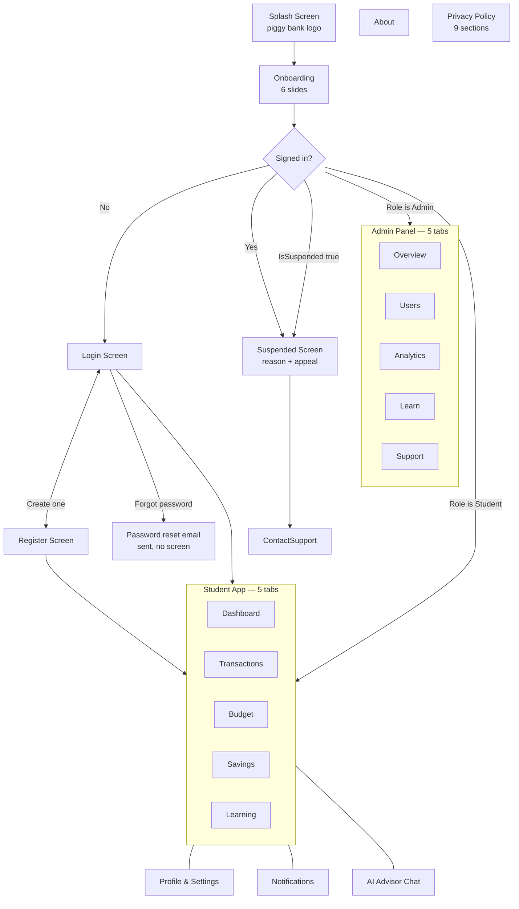

---

## 2. First Run Flow

What a brand new user sees, in order.

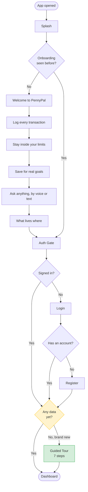

**Two separate first-run experiences.** Onboarding explains the app before there is an account. The guided tour explains the screen after there is one, and only on an account with no data, so an existing user is never interrupted on an update.

---

## 3. Student Navigation

The five tabs, plus everything reachable from the top bar.

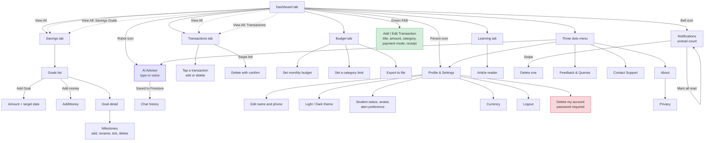

---

## 4. The Three Dots Menu

Everything in the top bar overflow, in the order it appears.

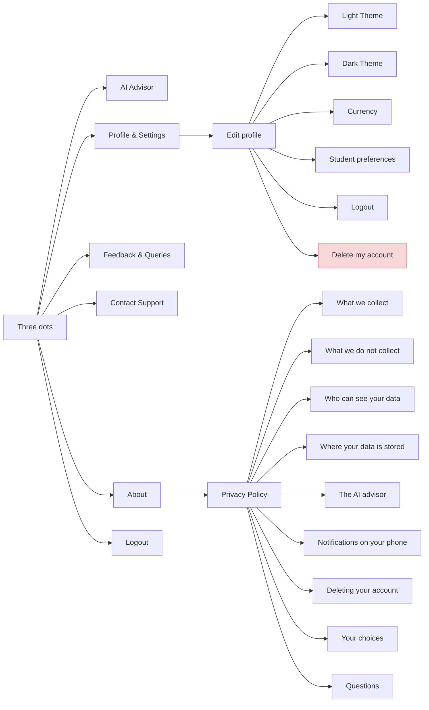

---

## 5. Add Transaction Flow

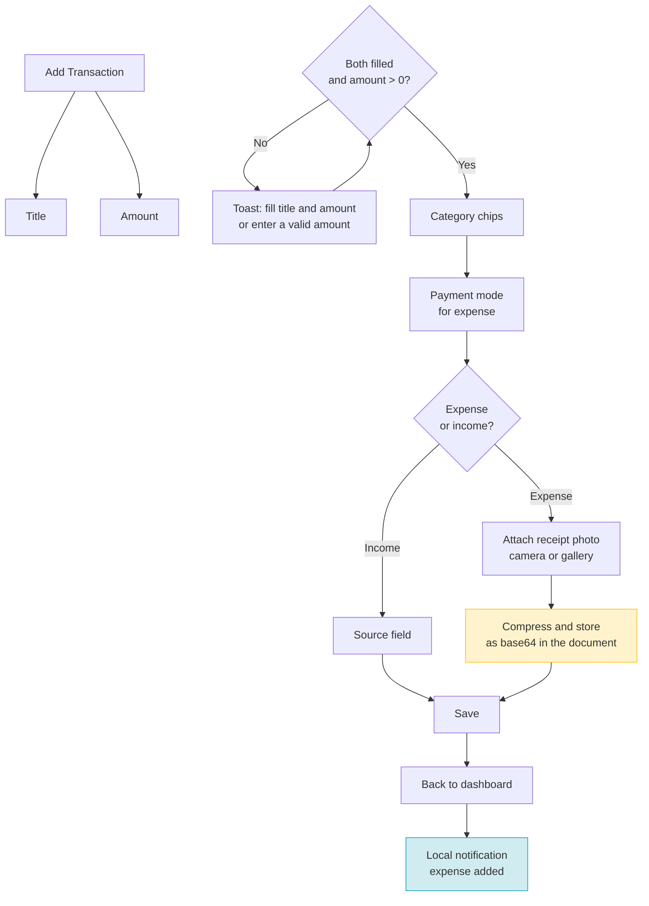

**Receipts only attach to an expense.** An income entry has no receipt, so the field is hidden rather than shown and ignored. The photo is compressed so it fits the 1 MiB Firestore document limit, which is what keeps the project on the free plan.

---

## 6. Budget and Warning Logic

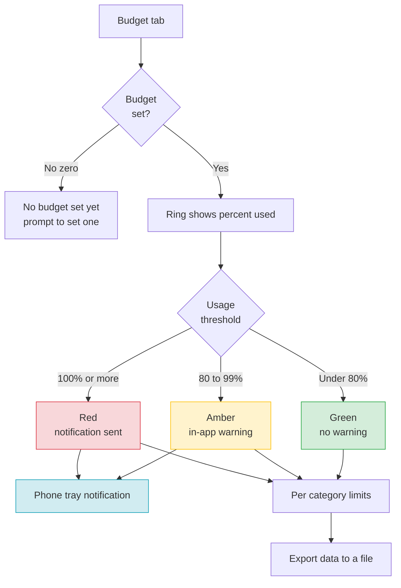

**A budget of zero is not shown as zero percent used.** It shows a prompt to set one, because an unconfigured budget and a budget of zero spending mean very different things and look identical otherwise.

---

## 7. Savings Goal and Milestone Flow

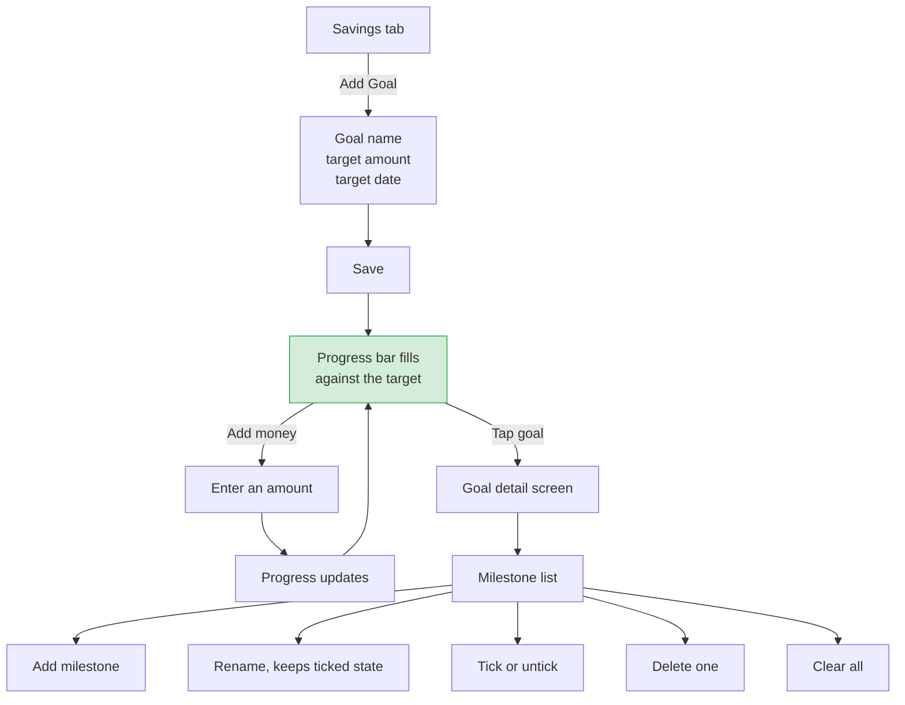

---

## 8. AI Advisor Flow

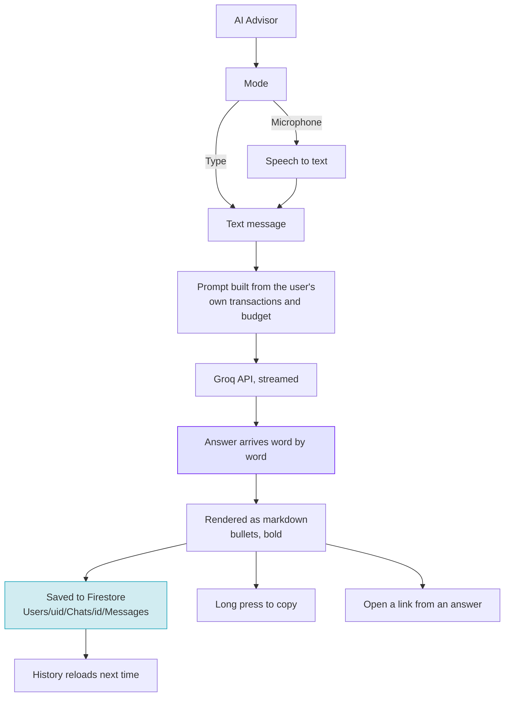

**The API key is never in the source.** It is read at runtime from a dart-define, a local `.env`, a bundled asset, or `web/env.js`, in that order. That is what keeps it out of version control while still working with a plain `flutter run`.

---

## 9. Account Deletion Flow

The one action in the app that fully completes.

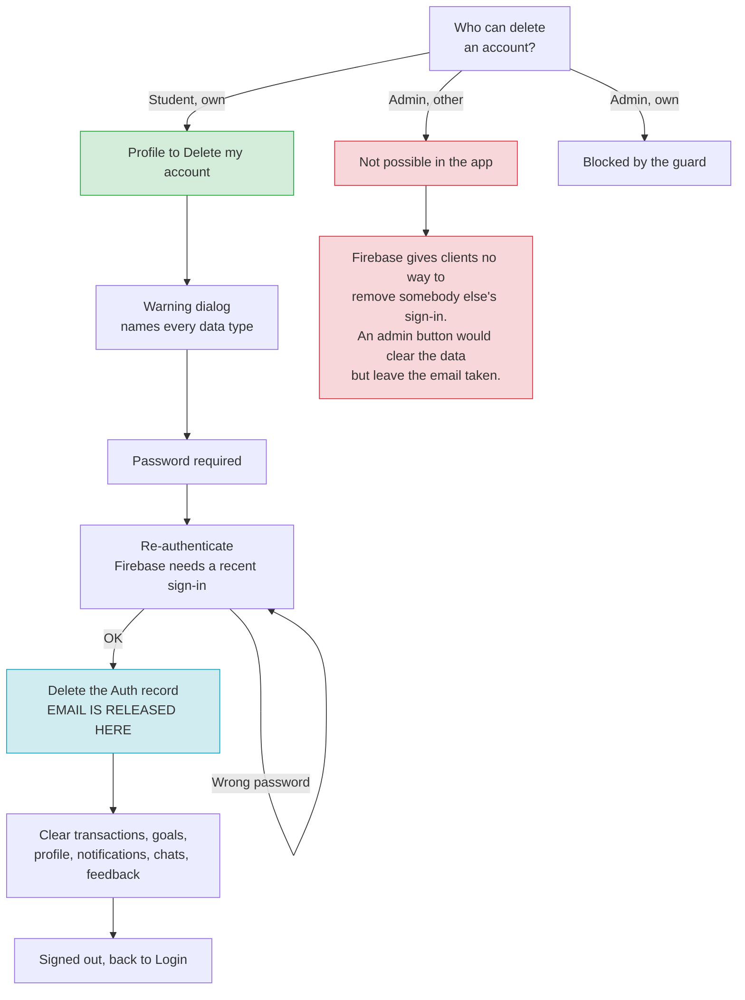

**Why the admin has no delete button.** Firebase deliberately exposes no client API for deleting another user's sign in, otherwise any signed in user could delete any other account. An admin button could only clear Firestore, which would leave the email registered and the student unable to sign up again. A control that half works is worse than none, so the button was removed and self service deletion is the answer.

**Order matters.** The sign in record is deleted first. If the second step fails, the data is still intact rather than orphaned under an account that no longer exists.

---

## 10. Admin Panel Navigation

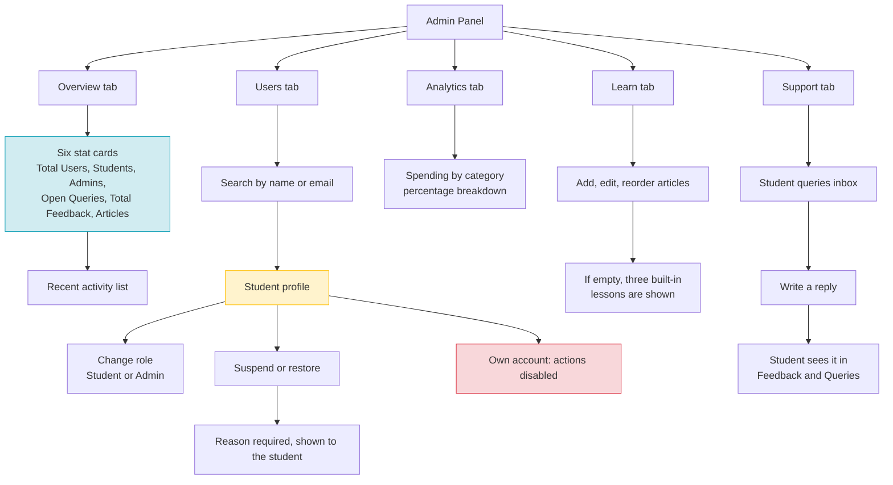

---

## 11. Suspension Flow

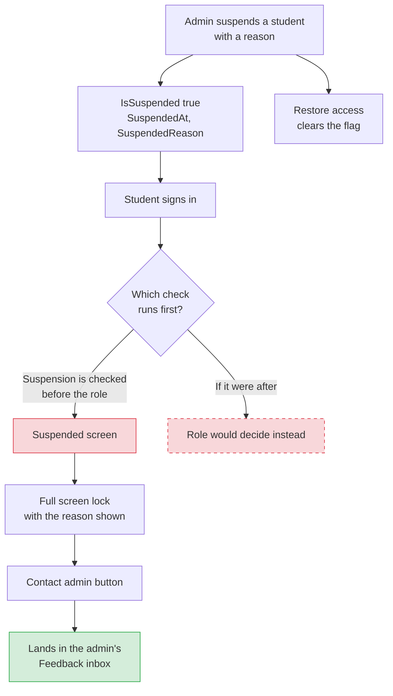

**Suspension is checked before the role.** That ordering means a suspended admin is locked out too, not just a suspended student. The dashed box shows the path that would exist if the order were reversed.

---

## 12. Feedback and Support Flow

Two separate routes into the admin inbox.

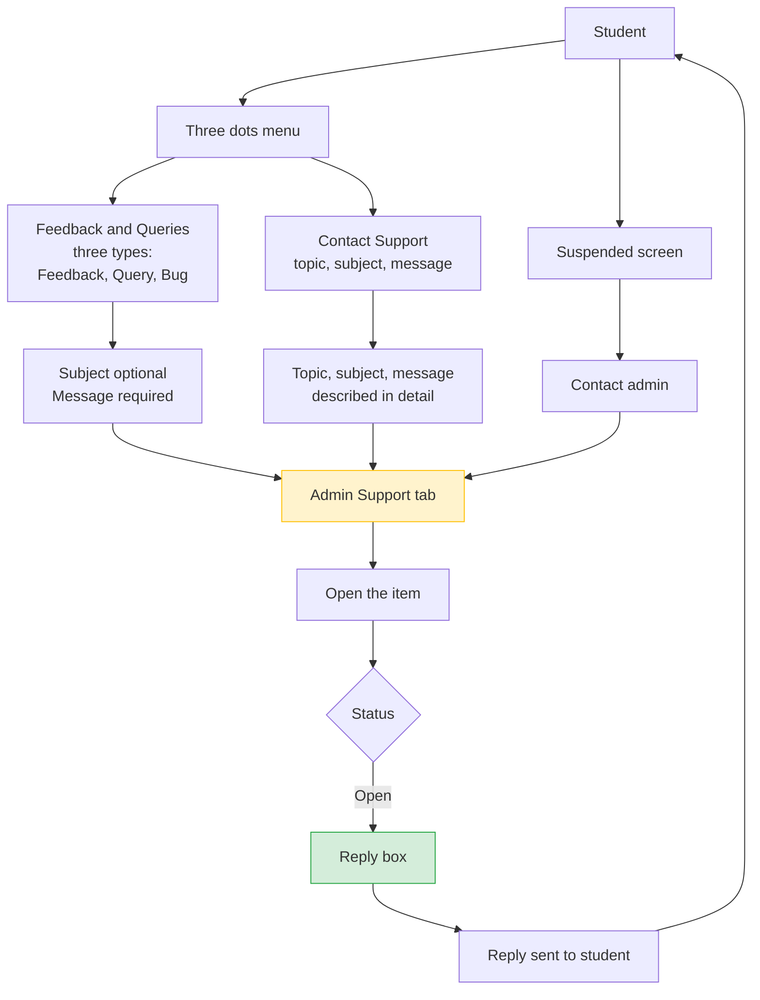

**A suspended student's appeal button routes into this same inbox.** That is deliberate, because a locked out student has no other way to reach an admin.

---

## 13. Notification Flow

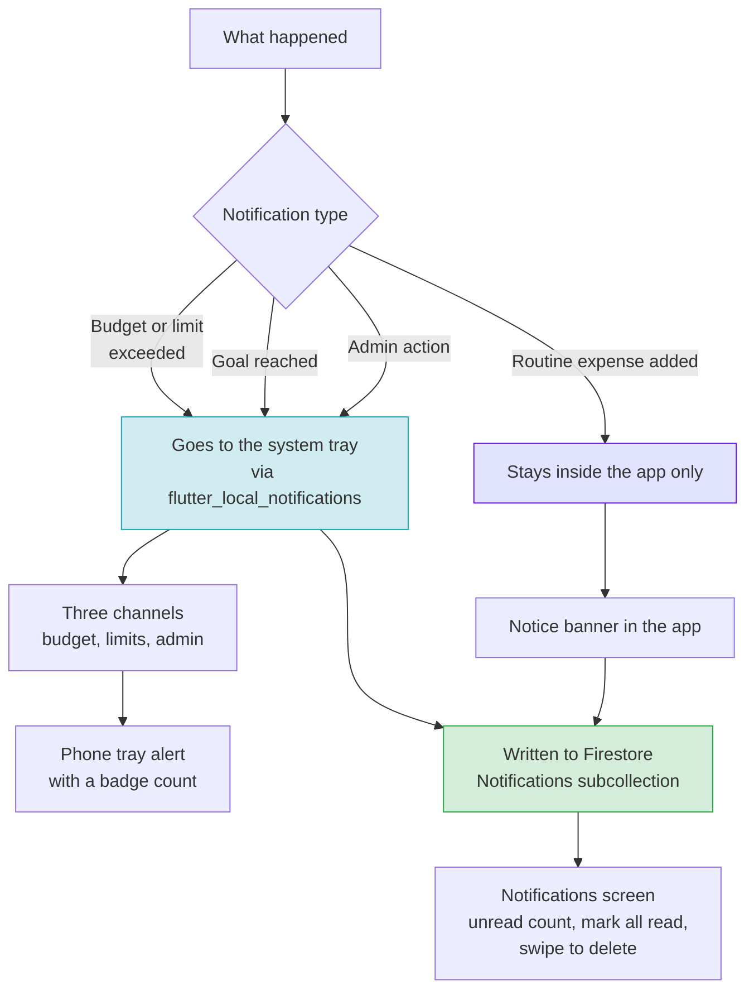

**Routine notifications stay inside the app on purpose.** Only budget, limit, goal, and admin events interrupt on the phone tray. Everything is written to Firestore either way, so the full history is the same.

**No FCM.** Cloud Messaging needs the Blaze plan. Notifications are generated in the app and a real system tray alert is raised locally, so the phone still buzzes without a server.

---

## 14. Data Model

How the Firestore collections are organised.

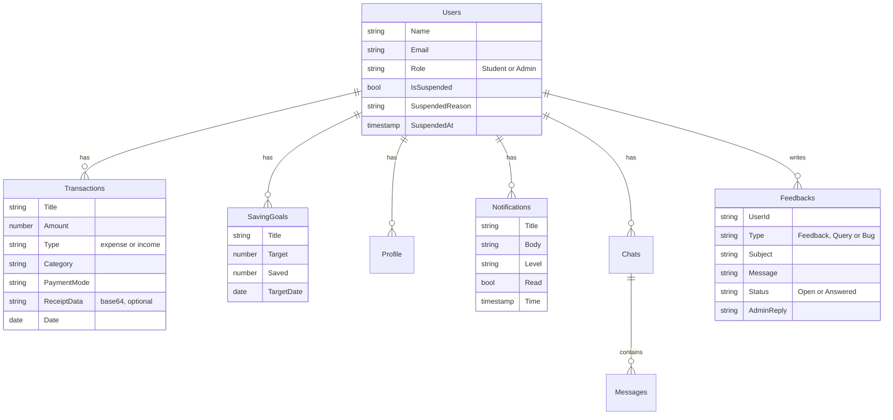

`Chats` is two levels deep, `Users/uid/Chats/chatId/Messages/messageId`, which is how the AI history is kept per user.

---

## 15. Role Based Access

What each role can reach.

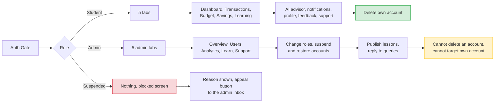

---

## 16. Onboarding and Tour Content

The actual copy, in order.

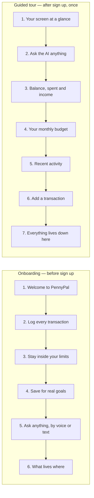

Both are stored in a preference rather than derived from the account, so a student who skips is never shown it again and an existing user is never interrupted on an update. Only one tour can ever be on screen, even if the dashboard builds more than once.

---

## 17. Navigation Structure Reference

A plain list, for writing documentation that does not need a diagram.

### Student tabs
| Tab | Screen | Key actions |
|---|---|---|
| Dashboard | Home | View All buttons, Add Transaction FAB, AI link, bell, profile |
| Transactions | Full list | Search, filters, date range, swipe delete, tap to edit |
| Budget | Limits | Set monthly budget, per category limits, export |
| Savings | Goals | Add goal, add money, milestones |
| Learning | Lessons | Read articles |

### Top bar
| Element | Goes to |
|---|---|
| Piggy bank logo | Wordmark, no action |
| Bell icon | Notifications screen |
| Person icon | Profile and Settings |
| Three dots | AI Advisor, Profile, Feedback, Contact Support, About, Logout |

### Profile section
| Item | What it does |
|---|---|
| Edit profile | Name and phone |
| Student preferences | Status, avatar, alert preference |
| Currency | Display currency |
| Light Theme | Switches to the white theme |
| Dark Theme | True black, the default look |
| Logout | Signs out and returns to Login |
| Delete my account | Password required, removes everything including the sign in |

### Admin tabs
| Tab | Screen | Key actions |
|---|---|---|
| Overview | 6 stat cards | Recent activity |
| Users | Search and list | Change role, suspend, restore |
| Analytics | Category breakdown | Percentage of spending |
| Learn | Article list | Add, edit, reorder, delete |
| Support | Query inbox | Reply to students |

### Privacy policy sections
1. What we collect
2. What we do not collect
3. Who can see your data
4. Where your data is stored
5. The AI advisor
6. Notifications on your phone
7. Deleting your account
8. Your choices
9. Questions

---

## 18. Screen Count

Roughly how the screens add up, useful for a documentation summary.

| Area | Screens |
|---|---|
| Entry | Splash, Onboarding, Auth Gate, Login, Register, Suspended |
| Student tabs | Dashboard, Transactions, Budget, Savings, Learning |
| Detail screens | Add Transaction, Goal detail, Article reader, Receipt viewer |
| Tools | AI Advisor, Notifications |
| Settings | Profile, About, Privacy Policy, Feedback, Contact Support |
| Admin | Admin shell, Overview, Users, User detail, Analytics, Learn, Support |

**Total: 24 screens**

---

## Rendering Notes

| Mermaid | Notes |
|---|---|
| ` ` inside a node label | Renders as a line break. Do not use `\n` |
| `subgraph` | Used above to group the student and admin tabs |
| `stroke-dasharray: 5 5` | Used for the counterfactual path in diagram 11 |
| `style` lines | Colour only, for readability in print |
| If a diagram fails | Paste it into mermaid.live to see the exact error |

**Exporting as an image.** Open the diagram at [mermaid.live](https://mermaid.live), then use the Actions menu to download an SVG or PNG. SVG stays sharp at any size, which is what you want for a document that may be printed.
